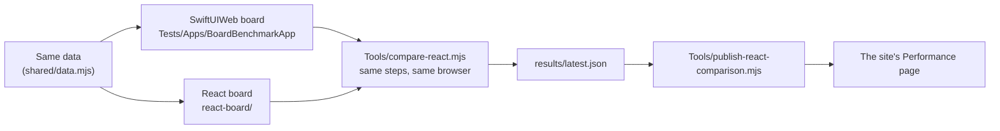

# SwiftUIWeb against React

The same small app, written twice and measured in one browser on one machine: a "works board" of 2,000 rows with a search,
favorites, a detail panel, an "add" button, a stats screen of 200 cells, and a scrolling list. It is the kind of screen an
internal tool is made of, so the numbers say something about that kind of work and nothing about others.



## Run it

```sh
(cd Benchmarks/ReactComparison/react-board && bun install && bun build.mjs)   # the React board, production build
BUILD_ONLY=1 CONFIGURATION=release Tools/run-browser.sh board                 # the SwiftUIWeb board, release build
bun Tools/test-react-board-parity.mjs                                         # both boards answer alike (run this first)
bun Tools/compare-react.mjs --rounds 15 --cpu 1,4 --network slow4g \
  --json Benchmarks/ReactComparison/results/latest.json
bun Tools/publish-react-comparison.mjs                                        # refresh the site's data
```

Close other work first: the numbers are about this machine at this moment, and a busy machine widens the spread. The runner
exits with an error before measuring if a board reports a page error, and it retries a failed run once.

## What makes it fair, and what does not

| | SwiftUIWeb | React |
|---|---|---|
| Build | release, Embedded Swift WebAssembly, content-hashed, precompressed | React 19, production, minified, content-hashed, precompressed (`react-board/build.mjs`) |
| Server | `Tools/bun-server.ts` | the same server, at the same time |
| Browser | a fresh Chromium and context for every run | the same |
| Data | `Tests/Apps/BoardBenchmarkApp/BoardData.swift` | `shared/data.mjs` (the same generator, checked by the parity test) |
| Rows | a lazy list: only the rows in view are built | every matching row is rendered, each in `React.memo`, the way a React developer writes a long list |
| Search | a case-insensitive substring of the title, recomputed per change | the same, in `useMemo` |
| Swift runs | in a Web Worker (the default), and again on the main thread (`?render-in-worker=0`) | on the main thread |

The two apps are not the same *code*, only the same *behavior*. React's list is written plainly, as a React developer writes a
long list: every matching row is in the DOM. The fourth side, **React (virtualized)**, is the same React app with
`?virtual=1`: `react-board/src/VirtualRows.jsx` renders only the rows in view plus a margin of 20 rows, with fixed 44 px rows
and a spacer for the scrollbar, written by hand with no library. It is the same bundle, so it is the same code path apart from
that list. SwiftUIWeb's list builds only the rows in view, as the virtualized React does. Read the virtualized column against the
plain React column for what virtualization buys React, and against SwiftUIWeb for whether that closes the gap.

## How it is measured

- **Four sides.** SwiftUIWeb as it runs by default (its Swift in a Web Worker), the same bundle with the Swift on the main
  thread, React, and React with the virtualized list. Each is compared with SwiftUIWeb or React as the report says, and the
  two SwiftUIWeb sides are never compared with each other.
- **Rounds.** Every round runs the scenario once on each side, in one of eight orders (the four rotations of the four sides
  and their reverses: each side is first, second, third and last equally often), each in a fresh browser. What the machine is
  doing at that moment is shared by all sides of a round.
- **Two readings per interaction.** Both start at the input event (`event.timeStamp`) and watch the page's own DOM for a
  condition (the result count says `125 results`, the detail shows the title, the grid has 200 cells). *On screen* ends at
  the frame that presents the change; *until the DOM is ready* ends when the DOM and its layout hold it. React writes the DOM
  inside the event, SwiftUIWeb commits it in the next animation frame, so the second reading shows the work and the first
  shows what the eye gets. The code is `recorder.mjs`, identical for all sides. Headless Chromium caps frames at 60 Hz, so
  the on-screen readings land on frame boundaries (about 17 ms apart).
- **Warm load.** After the scenario, the same address is loaded again in the same browser context. The HTTP cache holds the
  first visit's files, so the second visit fetches only `index.html` (revalidated) and nothing else: both sides' scripts and
  styles are content-hashed and served with a one-year `immutable` cache header. It is read the way the cold load is.
- **Slow 4G.** `--network slow4g` measures the cold load under `Network.emulateNetworkConditions`: 1.6 Mbps down (Chromium's
  Fast 3G bandwidth), 750 kbps up and a 150 ms round trip, added to each request. Chromium applies these conditions to the
  page's workers too: a 400 KB fetch made by a worker takes 2.16 s under them, against 2 ms without, so SwiftUIWeb's Swift
  worker and its wasm are slowed like the page. Only the cold-load metrics are kept for this profile; the interactions run
  on a local page either way. Its results are in the report under "Slow 4G" and in `results/latest.json` under `network`.
- **Core Web Vitals (Chromium).** The largest contentful paint is read when the board is on screen (cold load, and in the slow
  network profile). The layout shift is summed over the whole scenario, times 1000 so that it reads as a whole number. The
  interaction to next paint is the browser's own Event Timing for each input (the duration from the input to the frame that
  paints it); the row takes the slowest input of the scenario. A visit's INP is the 98th percentile over its inputs, so this
  is a worst case over the scenario's inputs, not that percentile. Chromium rounds Event Timing durations to 8 ms, so this row
  moves in steps of 8 ms and cannot tell two sides apart within one step. WebKit reports none of these, so the rows are left out.
- **Statistics.** Per metric, the median and the interquartile range of each side; the change of React against SwiftUIWeb as
  the median of the per-round differences; a 99 percent bootstrap interval over rounds; a Wilcoxon signed-rank test
  (`Tools/perf-ab-stats.mjs`). A difference is reported only when the interval excludes zero, p < 0.01, and the change is at
  least 5 percent (and half a millisecond for times). Everything else reads "no significant difference".
- **CPU 4x.** `Emulation.setCPUThrottlingRate` slows the CPU four times, applied before the page loads, to stand in for a
  phone or a laptop on battery. Chromium applies it to the page's main thread, and to nothing else: it refuses the command
  for a dedicated worker ("Operation is only supported for pages, not workers"). The default SwiftUIWeb side renders in a
  Web Worker, so at 4x that side's render work runs at full speed, while its main-thread work and all of React's work are
  slowed. The compare script attaches to each worker and sends it the same command, records the refusal for every run
  (`meta.throttle` in `results/latest.json`), and the report marks that side "not throttled" and does not compare it with
  React. The 4x comparison that holds is the main-thread side against React.

## WebKit

`SWIFTUIWEB_BROWSER_ENGINE=webkit` runs the same rounds in Playwright's WebKit (the engine of Safari), at the machine's own
speed: `bun Tools/compare-react.mjs --rounds 15 --cpu 1 --json Benchmarks/ReactComparison/results/webkit.json`. The results
are in `results/webkit.json` and `results/webkit.md`; the site shows Chromium only. Three things WebKit does not give here:

- **CPU 4x and the slow network** use Chromium's DevTools commands (`Emulation.setCPUThrottlingRate`,
  `Network.emulateNetworkConditions`). The compare script refuses `--network` under WebKit and measures 1x only.
- **Blocked time** (long tasks) is not read: WebKit has no Long Tasks API, its observer never reports, and the row is left out
  of the WebKit report rather than shown as zero.
- **Input time stamps.** A synthetic click's `event.timeStamp` is not on the page's clock in WebKit, so for those inputs the
  interaction is timed from the moment the action was issued. Typing keeps the input's own time stamp, as in Chromium.

Firefox does not launch in the sandbox this was measured in, so it is not measured.

## What it does not measure

What is still not measured, or not measured the way a phone would be:

- **SwiftUIWeb's worker at CPU 4x.** Chromium refuses CPU throttling for a dedicated worker, so the render work of the
  default SwiftUIWeb side runs at full speed at 4x and is reported as not throttled. Only the main-thread side is slowed
  as a whole at 4x. CPU 4x is an emulation on this Mac, not a phone's processor.
- **Safari itself, and Firefox.** The WebKit runs are Playwright's WebKit build on this Mac, not Safari on a Mac or an iPhone.
  Firefox does not launch in the sandbox this was measured in.
- **CPU 4x, the slow network, the blocked time and the Core Web Vitals in WebKit.** They are Chromium DevTools commands or
  entries, which WebKit does not provide here (see the WebKit section).
- **Network profiles other than slow 4G**, and any network effect on the interactions (they run on a local page).
- **The INP row is the slowest input, not the 98th percentile a visit reports,** and Chromium rounds its durations to 8 ms.
- **Cold disk cache.** Each cold load starts a fresh browser; the warm load reuses the browser's cache within one context.
- **Server-rendered first paint** (there is none on either side), memory pressure, battery use, and any screen other than this one.

It is one app on one machine: treat the direction of a difference as the finding, and its size as an example.

The first column of numbers in the site's Performance page comes from `results/latest.json`, which carries the date, the
machine, the browser, the number of rounds and every sample.
