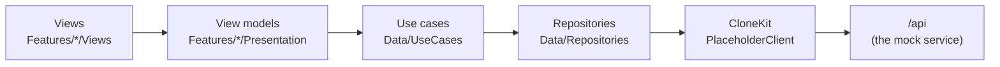

# Lumio

A photo-sharing app: a feed with stories, comments in a sheet, an explore grid with search and a profile. It is the template for the realistic
examples: a layered structure, a network service behind use cases and repositories, loading, failed and empty states,
and tests with doubles. The name, the mark (`LumioLogo`) and every picture are the project's own, drawn locally.



```sh
make run lumio                # build and serve it, starting the mock API (it prints the address)
API=real make run lumio       # the data from jsonplaceholder.typicode.com (the pictures stay local)
make lumio-test               # the browser test, on Chromium and WebKit
```

| Folder | What is in it |
|---|---|
| `App/` | `LumioDependencies`: every use case, in one place (`live` for the app, doubles in a test). |
| `Core/` | The design system (`LumioPalette`, `LumioLayout`), shared views (`LumioLogo`, `LumioAvatar`, `LumioStatusView`), `LoadState`. |
| `Data/` | `Domain` (people, posts, comments, tiles, profile), `Repositories` (protocols and their `Live` versions over `CloneKit`), `UseCases`. |
| `Features/` | `Feed`, `Comments`, `Explore`, `Profile` and `Shell`, each with `Presentation` (view models, strings) and `Views`. |

The `.mock-api` file makes the launcher start `Tools/mock-jsonplaceholder.mjs` for this example. Tests are in `Tests/LumioTests`
(view models and repositories, against doubles) and `Tools/test-lumio-browser.mjs` (the app against the mock, in a browser).

Embedded Swift cannot print an arbitrary error (`String(describing:)`), so a failure shows one message (`FailureText`); and a stored
closure that a button calls is `@MainActor @Sendable`.
