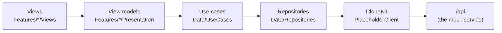

# Mailo

A mail client: folders (Inbox, Starred, Sent, Drafts, Trash), a list of messages with stars, checkboxes and pages, a reading pane with
the thread of replies, a compose sheet with drafts, and a search. It is the second of the realistic examples and follows the template of
[Lumio](../Lumio/README.md): a layered structure, a network service behind use cases and repositories, loading,
failed and empty states, and tests with doubles. The name, the mark (`MailoLogo`, an envelope under a sun) and the copy are the
project's own.



```sh
make run mailo                # build and serve it, starting the mock API (it prints the address)
API=real make run mailo       # the data from jsonplaceholder.typicode.com
make mailo-test               # the browser test, on Chromium and WebKit
```

## How the service becomes mail

| The service | Mailo |
|---|---|
| A post | A message. Its user is the sender (name, and the address from `email`), its title the subject, its body the text. |
| The posts of users other than user 1 | The inbox. The account is user 1: its posts are the sent mail. |
| A post sent by the account | Sent. The recipient the message was given is kept with the post (`to`). |
| The comments of a post | The thread of replies. A reply is a comment written as the account. |
| `q` | The search. The folder's filter goes in the same query (`userId_ne=1`, `userId=1`). |
| `DELETE /posts/:id` | Deleting a message from the Trash, for good. |

The service keeps no stars, no trash, no read marks and no drafts: `MailboxState` keeps them in memory for the session. The list of a
folder is the whole list the service answers for its filter; the pages (`1-20 of 90`) are cut from it on the device, because the transport
returns the body of an answer and not its headers, so the total is the length of the list. A message's time is derived from its id
(`MailTime`), since the service keeps no clock.

## Layout

| Folder | What is in it |
|---|---|
| `App/` | `MailoDependencies`: every use case, in one place (`live` for the app, doubles in a test). |
| `Core/` | The design system (`MailoPalette`, `MailoLayout`), shared views (`MailoLogo`, `MailoAvatar`, `MailoStatusView`), `LoadState`, `FailureText`. |
| `Data/` | `Domain` (people, messages, replies, folders, the account), `Repositories` (protocols and their `Live` versions over `CloneKit`), `UseCases`. |
| `Features/Shell` | The top bar with the search, the workspace (wide or narrow), the controller that holds the mailbox, the open message and the compose sheet. |
| `Features/Mailbox` | The folders, the list (`MailboxViewModel`, the in-memory `MailboxState`, the toolbar, the rows and the pager). |
| `Features/Reading` | The open message: its header, its body, its replies and the reply box. |
| `Features/Compose` | The compose sheet and its draft. |

## Layouts

On a window of 600 points or more the folders, the list and the reading pane sit side by side. Below that the folders become a row above
the list, and a message replaces the list with a Back button. The choice comes from the width the view is given (`GeometryReader`), so the
app does not depend on the device.

Embedded Swift cannot print an arbitrary error (`String(describing:)`), so a failure shows one message (`FailureText`); and a stored
closure that a button calls is `@MainActor @Sendable`.

Tests are in `Tests/MailoTests` (view models, repositories and the time of a message, against doubles) and `Tools/test-mailo-browser.mjs`
(the app against the mock, in a browser, on a desktop and on a phone).
