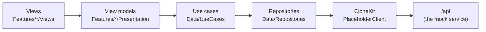

# Neighborly

A social network for a street: a feed with a composer, reactions and comments that open under a post, photos in albums, and profiles with
friends. It follows the template of [Lumio](../Lumio/README.md): a layered structure, a network service behind use cases
and repositories, loading, failed and empty states, and tests with doubles. The name, the mark (`NeighborlyLogo`) and every picture are the
project's own, drawn locally.



```sh
make run neighborly           # build and serve it, starting the mock API (it prints the address)
API=real make run neighborly  # the data from jsonplaceholder.typicode.com (the pictures stay local)
make neighborly-test          # the browser test, on Chromium and WebKit
```

## What it shows

- **Home.** A composer ("What is on your mind?") shares a post, which goes first in the feed. Each post has a like toggle with its count, and
  Comment opens the post's comments under it, where a comment can be written. The left column groups the feed by city (Neighbors in a city).
- **Photos.** The people to pick from, then the albums of the one picked. An album opens in place as a grid; a picture opens larger, with the
  pictures before and after it.
- **Profile.** A cover picture, the person, their counts and their friends. A friend's profile opens from the friends list, the contacts or a name
  in the feed.
- **Layout.** Three columns (shortcuts, the screen, contacts) when the window is wide enough for them; one column with a bottom bar when it is
  not, which is a phone. `ViewThatFits` picks the layout from the space the columns need, so the switch sits between 1,040 and 1,100 points: a phone and a tablet in portrait get one column.

| Folder | What is in it |
|---|---|
| `App/` | `NeighborlyDependencies`: every use case, in one place (`live` for the app, doubles in a test). |
| `Core/` | The design system (`NeighborlyPalette`, `NeighborlyLayout`), shared views (`NeighborlyLogo`, `NeighborlyAvatar`, `NeighborlyStatusView`), `LoadState`. |
| `Data/` | `Domain` (people, posts, comments, albums, photos, profiles), `Repositories` (protocols and their `Live` versions over `CloneKit`), `UseCases`. |
| `Features/` | `Feed`, `Contacts`, `Photos`, `Profile` and `Shell`, each with `Presentation` (view models, strings) and `Views`. |

The calls that CloneKit did not have are in [`Examples/CloneKit/Network/PlaceholderClient+Neighborly.swift`](../CloneKit/Network/PlaceholderClient+Neighborly.swift):
one user by id and a new post. The comments use the client's `addComment`. A commenter's name is found by the address the service keeps for
them, since the API has no user id on a comment.

The `.mock-api` file makes the launcher start `Tools/mock-jsonplaceholder.mjs` for this example. Tests are in `Tests/NeighborlyTests`
(view models and repositories, against doubles) and `Tools/test-neighborly-browser.mjs` (the app against the mock, in a browser).

Embedded Swift cannot print an arbitrary error (`String(describing:)`), so a failure shows one message (`FailureText`); a stored closure
that a button calls is `@MainActor @Sendable`; and the feed's groups are the cities of the people, sorted, not a second source of data.
