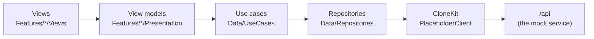

# Quill

A short-posts app in the spirit of the X-style timeline: a timeline with **For you** and **Following** tabs, a composer that posts a new
post to the top, likes and reposts that count, replies in a thread sheet with a reply composer, and trends and people to follow beside
the feed. It is the second realistic example over the mock API, after Lumio, and it has its own name and mark (`QuillLogo`, a feather
drawn with SwiftUI shapes): no brand of another product is used.



```sh
make run quill                # build and serve it, starting the mock API (it prints the address)
API=real make run quill       # the data from jsonplaceholder.typicode.com (the pictures stay local)
make quill-test               # the browser test, on Chromium and WebKit
```

## Layout

The window is responsive by one choice in `Features/Shell/Views/QuillRootView.swift`: a `ViewThatFits` with two candidates. The wide
candidate is the navigation rail (`QuillRail`), the timeline and the trends and people to follow (`SidebarColumn`), and it is used when
the window has room for the three columns (`QuillLayout`: 232 + 520 + 300 points). Otherwise the narrow candidate is the timeline with
`QuillBottomBar` (Home and the composer). The browser chooses the candidate, so the app has no breakpoint of its own.

Only the wide candidate shows the composer at the top of the feed and the right column; on the narrow one the composer is a sheet, opened
from the bottom bar, and the trends and the people to follow are not shown.

| Folder | What is in it |
|---|---|
| `App/` | `QuillDependencies`: every use case, in one place (`live` for the app, doubles in a test). |
| `Core/` | The design system (`QuillPalette`, `QuillLayout`), shared views (`QuillLogo`, `QuillAvatar`, `QuillPostHeader`, `QuillStatusView`), `LoadState`, `Numbers`. |
| `Data/` | `Domain` (users, posts, replies, trends, feeds), `Repositories` (protocols, their `Live` versions over `CloneKit`, and `QuillMapping` from the API's resources), `UseCases`. |
| `Features/` | `Timeline`, `Composer`, `PostDetail`, `Sidebar` and `Shell`, each with `Presentation` (view models, strings) and `Views`. |

The API has no counts for a post, so `QuillMapping` derives likes, reposts and replies from the post's id: the same numbers on every load,
and the thread shows as many replies as the count says (the mock keeps five under each post). The Following feed is the posts of users 1,
2 and 3, newest first, in one page.

The `.mock-api` file makes the launcher start `Tools/mock-jsonplaceholder.mjs` for this example. Tests are in `Tests/QuillTests`
(view models and repositories, against doubles) and `Tools/test-quill-browser.mjs` (the app against the mock, in a browser).

Embedded Swift cannot print an arbitrary error (`String(describing:)`), so a failure shows one message (`FailureText`); and a stored
closure that a button calls is `@MainActor @Sendable`.
