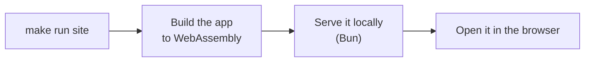

# Examples

Runnable apps built with SwiftUIWeb. Some are for people to learn from, others are fixtures the tests drive. Every one
keeps the app in ordinary SwiftUI-shaped code; only the entry point imports `SwiftUIWebBrowser` and conforms to `BrowserApp`.



## Run one

```sh
make list                   # the examples that have a short name
make run site               # the project site; also: lumio, quill, seekr, neighborly, stayly, mailo, media, avkit, photos-picker, map, notifications, security
```

`make run` with no name runs the project site (`EXAMPLE ?= site`). It builds for the installed Embedded Swift WebAssembly SDK and starts a local Bun server, which prints its address. Set `SWIFTUIWEB_OPEN_BROWSER=1` to also open a browser tab, or `CONFIGURATION=release` for an optimized bundle. `make run showcase` runs the component playground in [`Tests/Apps/ShowcaseApp`](../Tests/Apps/README.md) (a test app, not an example).
An example without a short name runs through `SWIFTUIWEB_PRODUCT=<Product> Tools/run-browser.sh x`.

## For people: learn from these

| Example | What it shows | Run |
|---|---|---|
| [`ShowcaseSite`](ShowcaseSite/README.md) | The project site, in Portuguese and English: the story, what the framework is for, its benefits, a measured comparison with React and a catalog of components with live knobs and the code they produce. Built with public SwiftUI API only, in a layered structure (use cases, repositories, view models). | `make run site` |
| [`Quill`](Quill/README.md) | A short-posts app (X-like): a timeline with For you and Following, a composer, likes, reposts, replies in a detail sheet, trends and who to follow, responsive from a navigation rail to a phone bottom bar, over a local jsonplaceholder-shaped API. Its own name and mark. | `make run quill` |
| [`Lumio`](Lumio/README.md) | A photo-sharing app (feed with stories, comments, explore with search, profile) over a local jsonplaceholder-shaped API, in a layered structure: use cases, repositories, view models, doubles in the tests. The template for the realistic examples. | `make run lumio` |
| [`Seekr`](Seekr/README.md) | A web search app: a home page with suggestions as you type and "I am feeling lucky", results with a breadcrumb, a snippet with the query in bold, "People also ask" and pages, an Images tab with a preview, and News. Over the same local API as Lumio, its own name and mark. | `make run seekr` |
| [`Neighborly`](Neighborly/README.md) | A social network (a feed with a composer, reactions and inline comments, photos in albums, profiles with friends) over the same local API: three columns on a wide screen, one column and a bottom bar on a phone. The name, the mark (`NeighborlyLogo`) and the pictures are the project's own. | `make run neighborly` |
| [`Stayly`](Stayly/README.md) | An accommodation app (search by city, dates and guests; results with filters and an order; a stay page with a gallery, host and booking; trips and saved stays) over the same local API, in the layered structure of Lumio. | `make run stayly` |
| [`Mailo`](Mailo/README.md) | A mail client (folders, a list with stars, checkboxes and pages, reading with the thread of replies, compose with drafts, search) over the same local API. Wide screens show the list and the message side by side; a phone shows one at a time. | `make run mailo` |
| [`MediaExample`](MediaExample) | `SwiftUIWebAVFoundation`: an `AVPlayer`-shaped player (play, pause, seek, rate, volume, mute) that drives a native media element. | `make run media` |
| [`AVKitExample`](AVKitExample) | `SwiftUIWebAVKit`: `VideoPlayer` with ready-made controls over MP4, HLS and adaptive DASH streams. Shaka is downloaded only for the adaptive stream. | `make run avkit` |
| [`PhotosPickerExample`](PhotosPickerExample) | `SwiftUIWebPhotosUI`: pick images and videos, with ordered multiple selection and a limit, loading bytes asynchronously. Browser `File` objects never leave the adapter. | `make run photos-picker` |
| [`MapKitExample`](MapKitExample) | `SwiftUIWebMapKit`: a keyless map with markers, annotations, polyline and polygon overlays, selection and camera changes. Provider options (self-hosted, PMTiles, MapTiler, Stadia) are documented in `Sources/SwiftUIWebMapKit/MapKit.swift`. | `make run map` |
| [`UserNotificationsExample`](UserNotificationsExample) | `SwiftUIWebUserNotifications`: shows the permission state, asks for authorization and posts a local notification. Web Push is not included because it needs a service worker and a backend. | `make run notifications` |
| [`WebKitExample`](WebKitExample) | `SwiftUIWebWeb`: `WebContentView` loading a URL or HTML, with navigation state, reload/back/forward and the same-origin boundary for links. | `make run webkit` |
| [`SecurityExample`](SecurityExample) | `SwiftUIWebSecurity`: stores a secret with `SecItemAdd`, finds it again after a reload with `SecItemCopyMatching`, and forgets it. At rest it is AES-GCM ciphertext in IndexedDB. | `make run security` |

### Shared by the examples

| Folder | What it is |
|---|---|
| [`CloneKit`](CloneKit/README.md) | The models and the typed client of the jsonplaceholder-shaped API, and the paths of the pictures the mock service draws. The mock itself is `Tools/mock-jsonplaceholder.mjs`. |

### Separate packages (own README)

These are full packages with their own `Package.swift`.

| Example | What it shows | Run |
|---|---|---|
| [`UniversalApp`](UniversalApp/README.md) | The cross-host example: one `TabView` and `NavigationStack` in its shared sources, with a thin iOS/iPadOS entry point in `Darwin/` and a thin `BrowserApp` in `Web/`. | Xcode: open `project.xcworkspace`; web, from its folder: `SWIFTUIWEB_ROOT=../.. swift ../../Tools/swiftuiweb-run.swift --path . --product UniversalWebApp --port 8080` |
| [`Trio`](Trio/README.md) | iOS, Android and the Web from one package, in the layout of the Lumio example: a Skip Fuse app whose shared sources also build for the browser (`make trio-web`). | `make trio-web` |
| [`FoodTruck`](FoodTruck/README.md) | Apple's Food Truck sample, unmodified apart from a short list of adaptations, running in the browser. It exists to find the SwiftUI the framework still lacked. | `swift Tools/swiftuiweb-run.swift --path Examples/FoodTruck --product FoodTruckWeb` (from the repository root) |
| [`BlocklyInterop`](BlocklyInterop/README.md) | The official Blockly editor mounted in a ShadowRoot through `DOMViewRepresentable` and a registered component: creation, in-place updates, events back to Swift and teardown, without an iframe. | `./run.sh` (from its folder) |

## Small apps: fifteen apps that press on the browser host

Fifteen SwiftUI apps, one package each, every one compiled two ways from a single source tree: SwiftUI on iOS and
SwiftUIWeb (Embedded Swift/WebAssembly) in the browser. Each is written the way an iOS developer would write it
for iOS 17, with the natural API for the job and no platform branch. Nothing avoids an API because the browser
might lack it: a browser that cannot build or draw an app is the finding, and the fix goes into the framework.

Thirteen of them re-create the behaviour of an app from the MIT-licensed
[expo/exact](https://github.com/expo/exact/tree/main/apps) repository, whose screens are written in its own
declarative language, not Swift. They are rewrites from that specification, with their own names, text, data and
drawing. MonthCalendar has no counterpart there.

### The apps

| App | After | What it presses on |
|---|---|---|
| [MonthCalendar](MonthCalendar/README.md) | (own) | `Calendar` arithmetic, `Date.FormatStyle`, `LazyVGrid`, a `Form` sheet, swipe actions |
| [Sparkline](Sparkline/README.md) | sparkline | `Shape` + `trim` draw-in, a `TimelineView` pulse, `List` |
| [Carousel](Carousel/README.md) | carousel | 25,000 lazy cards, `scrollPosition(id:)`, nested lazy lists |
| [SwipeDeck](SwipeDeck/README.md) | spark | `DragGesture`, springs, a `ZStack` of cards, a scheme set on a subtree |
| [MotionGallery](MotionGallery/README.md) | motion-gallery | repeating animation, `PhaseAnimator`, `KeyframeAnimator`, `TimelineView` |
| [ShapeGallery](ShapeGallery/README.md) | svg-gallery | `Path`, strokes, gradients, clips, masks, blend modes, transforms |
| [CanvasGallery](CanvasGallery/README.md) | canvas-gallery | `Canvas` and `GraphicsContext`: filters, layers, clips, text |
| [MarkdownReader](MarkdownReader/README.md) | markdown | a block parser, `AttributedString(markdown:)`, `Grid`, `ScrollViewReader` |
| [TextStudies](TextStudies/README.md) | reflow | text measured in `Canvas`, custom `Layout`, re-flow every frame |
| [WrapAround](WrapAround/README.md) | textflow | a custom `Layout` flowing words around moving shapes, `layoutValue` |
| [Skies](Skies/README.md) | weatherlight | `URLSession` + `Codable`, `refreshable`, `searchable`, an animated `Canvas` sky |
| [PocketOS](PocketOS/README.md) | expose | `matchedGeometryEffect`, `AsyncStream`, `safeAreaInset`, `@AppStorage` |
| [StoreMap](StoreMap/README.md) | map-demo | MapKit's `Map`, `Marker`, selection, camera |
| [ClipPlayer](ClipPlayer/README.md) | video-player | AVKit's `VideoPlayer`, `AVPlayer` observers, notifications |
| [PhotoEditor](PhotoEditor/README.md) | photo-editor | magnify, rotate and drag gestures, `PhotosPicker`, `ImageRenderer` |

All fifteen build and run on iOS, and build and open in the browser.

### How each app is laid out

```text
<App>/
├── Package.swift        a SwiftUI library for iOS; the SwiftUIWeb package when SWIFTUIWEB_EMBEDDED=1
├── Sources/<App>/       the whole app, shared by both hosts
│   ├── App/             <App>RootView, which both hosts load
│   ├── Features/        one folder per screen or flow: its ViewModel and its Views/
│   ├── Data/            models, repositories and sample data
│   └── Core/            Strings and small helpers
├── Darwin/              the iOS Xcode host: Main.swift loads <App>RootView
└── Web/                 the browser host: a BrowserApp that loads <App>RootView
```

The code follows the rules of the author's production apps: View -> ViewModel -> Repository, a ViewModel that is
an `@Observable @MainActor final class` with `State`, `Action` and one `send(_:)`, one type and one `View` per
file, no file over 200 lines, user-visible text in `Core/Strings.swift`, no force unwrap.

In the browser build the package aliases the Apple module names the sources import (`SwiftUI`, `Foundation`, and
`MapKit`, `AVKit`, `PhotosUI` where used) to SwiftUIWeb's modules, so no source file has a platform branch.

### What the browser asked of the source

The apps found API the framework lacked, which was added to the framework rather than avoided in the apps: C math
(`sin`, `cos`, `atan2`...), `Calendar` intervals and ranges, `NotificationCenter.notifications(named:)`, printf
formatting, `Path.addLines`, tangent arcs and `strokedPath`, `GraphicsContext` filters and blend modes,
`Button(_:systemImage:)`, grid cell modifiers, the bottom bar, `Bindable(_:)`, `Image` as `Transferable` and
others (see "API and behaviour found by the example apps" in `Documentation/MIGRATION.md`). The source lowerer
learned two forms: a key path passed as a function (`split(whereSeparator: \.isNewline)`) and
`Bindable(model).member`.

Two things Embedded Swift cannot express stay out of the apps, with a comment where they would be:

- a key path kept as a value (`WritableKeyPath<Edit, Double>` for PhotoEditor's adjustments);
- a cast from `Any` (`notification.userInfo?[key] as? Error` in ClipPlayer).

### What the browser still gets wrong

Opening an app is not the same as matching iOS. Compared side by side with the simulator, these differences are
known and open:

| App | Difference in the browser | Where the cause is |
|---|---|---|
| MarkdownReader | The inline title runs under the four bar items | The inset rule counts single toolbar items, not a `ToolbarItemGroup` |
| MarkdownReader | A link in the text takes the accent colour, which is near-black in the default theme; iOS uses blue | The framework's default tint |
| MotionGallery | The "sweep" tile does not move: a state change made in `onAppear` lands in the first commit, so there is no start value to animate from | Lifecycle order in the Fiber runtime |
| PocketOS | A plain `Button` draws as a filled button, hiding the app's own capsule; iOS's automatic style is plain text | The base rule of the automatic button style |
| SwipeDeck | `heart.fill` and `star.fill` draw as outlines | The icon adapter maps a `.fill` symbol to the same outline |
| CanvasGallery | `GraphicsContext` filters and blend modes with no canvas counterpart are approximated or ignored | Listed in `Documentation/LIMITATIONS.md` |
| ClipPlayer | Not confirmed: the test Chromium has no H.264 decoder, so the MP4 clip does not play there | The test browser |

### Run one

Browser, from the repository root:

```sh
make example-web EXAMPLE=Skies      # build and serve one app
make example-browser-test           # build all fifteen, then open each in Chromium
```

iOS: each app is its own project. Open `<App>/Darwin/<App>.xcodeproj` (for example `Skies/Darwin/Skies.xcodeproj`),
pick the "<App> App" scheme and run it on a simulator.

Requirements: Xcode for iOS; the Embedded Swift WebAssembly SDK for the browser (see the repository README).

### iOS and the browser only

[Trio](Trio/README.md) is the example of one package for iOS, Android (Skip Fuse) and the browser. These apps have
no Android host: Skip Fuse UI 1.19 does not declare `TimelineView`, `Canvas`, `GraphicsContext`, `Grid`,
`KeyframeAnimator`, `PhaseAnimator`, `ImageRenderer`, `PhotosPicker`, `ContentUnavailableView`,
`matchedGeometryEffect`, `transformEffect`, `contentShape` or `layoutValue`, marks `Layout`, `scrollPosition`,
`safeAreaInset`, `textSelection`, `monospacedDigit` and `contentTransition` unavailable, has no MapKit, AVKit or
PhotosUI module, and forbids `private` on `@State` properties and on views, all of which the apps use as ordinary
SwiftUI.

## Test apps

The apps the tests drive (the component playground, layout and lowering conformance, the media probe, the board benchmark and the view transition fixture) are not examples. They live in
[`Tests/Apps`](../Tests/Apps/README.md).

## The host boundary

Only the executable boundary imports `SwiftUIWebBrowser`:

```swift
import SwiftUIWeb
import SwiftUIWebBrowser

@main
struct Demo: BrowserApp {
  var body: some View { WindowGroup { Text("Hello") } }
}
```

The view hierarchy stays ordinary SwiftUI-style code. The browser DOM and the Fiber internals remain framework details.
For how the examples relate to tests and fixtures, see [`Documentation/TEST_LAYOUT.md`](../Documentation/TEST_LAYOUT.md).
