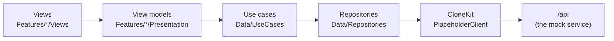

# Seekr

A web search app: a home page with the search and "I am feeling lucky", suggestions as you type, results with a breadcrumb, a title
link and a snippet with the query's words in bold, "People also ask", a count and the pages, an Images tab with a preview, and News
(the newest matching posts first). The name, the wordmark and the mark (`SeekrWordmark`, `SeekrMark`) are the project's own, drawn with
text and shapes. It follows the layers of [Lumio](../Lumio/README.md): the features, the view models, use cases, repositories over
CloneKit, and tests with doubles.



```sh
make run seekr                # build and serve it, starting the mock API (it prints the address)
API=real make run seekr       # the data from jsonplaceholder.typicode.com (the pictures stay local)
make seekr-test               # the browser test, on Chromium and WebKit
```

| Folder | What is in it |
|---|---|
| `App/` | `SeekrDependencies`: every use case, in one place (`live` for the app, doubles in a test). |
| `Core/` | The design system (`SeekrPalette`, `SeekrLayout`), the mark and the wordmark, `SeekrStatusView`, `LoadState`. |
| `Data/` | `Domain` (results, a page of results, pictures), `Repositories` (protocols and their `Live` versions over `CloneKit`), `UseCases`. |
| `Features/` | `Shell` (the route, the search box's text, the recent searches), `Search` (the search box and its suggestions), `Home`, `Results` (All, News, the pager, the snippets) and `Images`. |

## Where the data comes from

- **Results** are the posts whose text matches the query (`/api/posts?q=`), a page at a time (`_page`, `_limit`). The site of a result
  is the website of the user who wrote the post, and the breadcrumb shows it.
- **The count** ("About 42 results") and the pages come from one more call that lists every matching post: a page carries no total.
- **Suggestions** are the titles of the posts that begin the way the text has been typed, at most five.
- **People also ask** are the names of the first three comments on the top result, shown as questions; a click searches for one.
- **News** are the same matching posts, newest first (`_sort=id&_order=desc`).
- **Images** are the API's photos whose titles match the query (`/api/photos?q=`), drawn by the mock service.
- **I am feeling lucky** opens the link of the first result in a new page.

The time of a search is not shown: Embedded Swift has no clock without Foundation, and the line would be a guess.

The `.mock-api` file makes the launcher start `Tools/mock-jsonplaceholder.mjs` for this example. Tests are in `Tests/SeekrTests`
(view models and repositories, against doubles) and `Tools/test-seekr-browser.mjs` (the app against the mock, in a browser).

Embedded Swift cannot print an arbitrary error, so a failure shows one message (`FailureText`); a stored closure that a button calls is
`@MainActor @Sendable`; and bold words are separate `Text` values joined with `+`, never one string.
