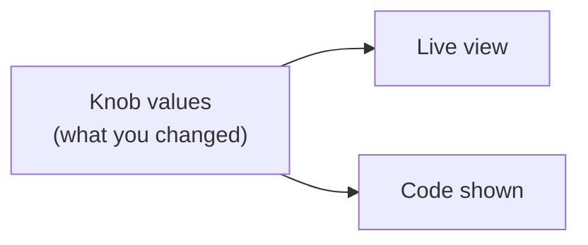

# ShowcaseSite

The project's own site, written with SwiftUIWeb: what it is for (with the README's counter running beside its code), how to get started, its
benefits, a measured comparison with React (the headline numbers first, every bar folded away), and a catalog of components you can change
live. It is in Portuguese and English, and light or dark (one menu in the header; the first visit follows the browser).

```sh
make run site            # build and serve it (it prints the address)
make showcase-site-test  # the browser test, in Chromium and WebKit
swift test --filter ShowcaseSiteTests
```

## Addresses

Every page has a readable address with the language first: `/pt/purpose`, `/en/start`, `/en/benefits`, `/pt/components/slider`; `/pt` alone opens the first page in Portuguese. A link or a
reload opens the page, the language and the catalog entry it names; Back and Forward go through the pages visited; choosing
another entry or another language changes the address without adding a history entry. The title and description follow the
page. See "Readable addresses per screen" in
[`Documentation/BROWSER_APP_SHELL.md`](../../Documentation/BROWSER_APP_SHELL.md): `SiteRoute` reads and writes the address,
`SitePageMetadata` gives each page its `.path`, `.navigationTitle` and `.documentHead`, and `SiteRootView` reads the address
back in `onOpenURL`.

## The catalog

Each component is one recipe. A recipe has knobs (a switch, a choice, a number, a text) and builds two things from the
same knob values: the live view and the code that would produce it. They cannot drift apart because a test changes every
knob of every recipe and fails if the code does not change.



To add a component, add a `Features/Components/Recipes/<Name>CatalogRecipe.swift` (the knobs and the code) and a
`<Name>CatalogPreview.swift` (the view), then list the recipe in `Data/Repositories/LiveComponentCatalogRepository.swift`.
A recipe says which public types it shows (`covers: ["VStack", "HStack"]`).

`Tools/audit-showcase-catalog.mjs` (run by `make tools-test`) checks the catalog against the public API: every public `View`
must be covered by a recipe, or listed with a reason in [`catalog-coverage.json`](catalog-coverage.json) as `exempt` (not a
component to configure, such as `AnyView`) or `pending` (an entry still to write). A new public view with none of these
fails the audit, and a type that gets an entry must leave `pending`.

## How the code is organized

The site follows the layout of the Lumio example, so the same habits apply:

```text
ShowcaseSite/
├── main.swift                      the @main BrowserApp, nothing else
├── App/                            SiteDependencies: the use cases the site needs, `live` or test doubles
├── Core/                           Language, design tokens and the small views every page shares
├── Data/
│   ├── Domain/                     SitePage, SiteAppearance and the catalog model
│   ├── Repositories/               protocols, and the live implementations
│   ├── UseCases/                   one use case per file: a protocol and its Default implementation
│   └── ViewObjects/                VO types that shape state for a view
└── Features/<Feature>/
    ├── Presentation/               @Observable view models, *Strings.swift, VO types
    └── Views/                      one View per file, rendering the view model's state
```

The rules, checked by review:

- A source file stays near 200 lines or fewer, and holds one production `View`. A fragment of a screen is its own `View`
  type, not a computed property or a helper that returns `some View`.
- Views render state and send actions. Anything that is not drawing goes to a view model, and the view model reaches data
  only through a use case, so a test builds it with a double (`Tests/ShowcaseSiteTests`).
- View models are `@MainActor @Observable`, held with `@State` by the view that owns them.
- Words on the screen live in the feature's `*Strings.swift`, written once per language side by side with
  `language.pick(pt:en:)`, one string per sentence, never joined. The catalog's own copy (a component's summary, a knob's
  label) sits in its recipe as `CatalogText`, because the copy and the component change together.
- Only public SwiftUI API is used, so the site is also a check that the API is enough to build a real page.
