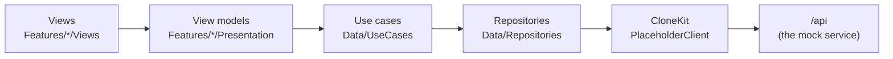

# Stayly

An accommodation app in the shape of a booking site: search by city, dates and guests, a results list with filters and an order, a
stay's page with a photo gallery, its host, its description and what it offers, a booking panel, the trips reserved in this session, and
a list of the stays saved with a heart. The name, the mark (`StaylyLogo`) and every picture are the project's own, drawn locally.



```sh
make run stayly               # build and serve it, starting the mock API (it prints the address)
API=real make run stayly      # the data from jsonplaceholder.typicode.com (the pictures stay local)
make stayly-test              # the browser test, on Chromium and WebKit
```

| Folder | What is in it |
|---|---|
| `App/` | `StaylyDependencies` (every use case, in one place: `live` for the app, doubles in a test) and `StaySession` (the hearts and the trips of this session). |
| `Core/` | The design system (`StaylyPalette`, `StaylyLayout`), shared views (`StaylyLogo`, `StayCard`, `StayFavoriteButton`, `StayRatingBadge`, `StaylyStatusView`), the dates and numbers the pages write (`StayDays`, `StayFormat`), the copy that several screens share (`StayCopy`), `LoadState`. |
| `Data/` | `Domain` (a stay, its host, its detail, its photos, a reservation, a search, the filters), `Repositories` (protocols, their `Live` versions over `CloneKit`, and `StayTerms`, the terms the API does not send), `UseCases`. |
| `Features/` | `Search` (the form and the Explore flow), `Results` (the filters beside the list, or in a sheet on a phone), `Detail` (the page and the booking), `Saved` and `Trips`, each with `Presentation` (view models, strings) and `Views`. |

A stay is an album: its owner's address is the city and the host, and the description is the body of the post with the same number. The
price per night, the rating, the capacity and the amenities are not in the API, so `StayTerms` derives them from the album's number: every
run shows the same stays. Reserving posts a to-do for the host (`/todos`); the trip itself stays in the session.

Dates are day numbers (`StayDays`), not Foundation's `Calendar`, which Embedded Swift does not have. Nights are at least one, and a check-out
never comes before the check-in. The results and the detail read the same search, so a stay's total is the nights of that search times its
price per night.

The filters sit beside the results when the screen is wider than 600 points and open in a sheet below that. `DatePicker` is a fallback
control in the feature matrix (the browser's own date field), not a native one: it works, but its look is the browser's.

The `.mock-api` file makes the launcher start `Tools/mock-jsonplaceholder.mjs` for this example. Tests are in `Tests/StaylyTests`
(view models, repositories and the date arithmetic, against doubles) and `Tools/test-stayly-browser.mjs` (the app against the mock, in a
browser, with a phone check).

Embedded Swift cannot print an arbitrary error (`String(describing:)`), so a failure shows one message (`FailureText`), and a stored closure
that a button calls is `@MainActor @Sendable`. Prices and ratings are whole numbers (a rating in tenths), so no `Double` is printed.
