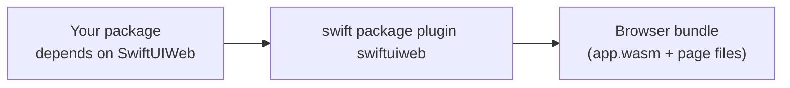

# Plugins

SwiftUIWeb ships two SwiftPM plugins.

| Plugin | Kind | What it is for |
|---|---|---|
| [`SwiftUIWebWebPlugin`](SwiftUIWebWebPlugin/README.md) | command plugin (`swift package web init`) | Writes `./swiftweb`, the script that runs the development loop, builds and the toolchain report for your package. Start here. |
| [`SwiftUIWebPlugin`](SwiftUIWebPlugin/README.md) | command plugin (`swift package plugin swiftuiweb`) | Builds your app for the browser: it runs the same launcher the framework uses, so a consumer package needs no scripts of its own. |

Read [`SwiftUIWebPlugin/README.md`](SwiftUIWebPlugin/README.md) for how it works and what it deliberately does not do.
