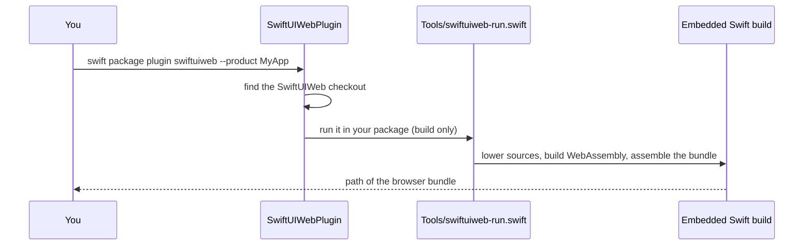

# SwiftUIWebPlugin

A SwiftPM **command plugin**. From your own package, one command builds your app for the browser:

```sh
swift package plugin swiftuiweb --path . --product MyApp
```

`--path .` is your package root and `--product` is the executable target that conforms to `BrowserApp`. The command prints
the folder with the finished bundle (`app.wasm`, the page, the JavaScript host and the stylesheet).

## What it does

The plugin is a thin wrapper. The real work lives in the launcher, [`Tools/swiftuiweb-run.swift`](../../Tools/swiftuiweb-run.swift),
which the framework also uses for its own examples. The plugin only prepares the call.



In order:

1. **Finds SwiftUIWeb.** It uses `SWIFTUIWEB_ROOT` if set; otherwise the SwiftUIWeb package among your dependencies;
   otherwise, when you run it inside the SwiftUIWeb checkout itself, that checkout.
2. **Points the launcher at your package.** It adds `--package-root` (unless you passed `--path`), so your own
   `Package.swift` and path dependencies are used as they are.
3. **Forces build-only.** It appends `--build-only` unless you asked for help.
4. **Keeps its output in SwiftPM's plugin work folder.** The build and the bundle go to a disposable folder there, so
   nothing is written into your sources.
5. **Forwards Ctrl-C.** `SIGINT`, `SIGTERM` and `SIGHUP` are passed to the launcher so a cancelled build stops cleanly.

## Why it does not start a server

SwiftPM sandboxes command plugins and gives them no network permission, so a plugin cannot listen on a localhost port.
Passing `--serve` or `--port` therefore fails with a message that points to the launcher. To serve your app locally, call
the launcher directly from your package:

```sh
SWIFTUIWEB_ROOT=../swiftuiweb \
  swift ../SwiftUIWeb/Tools/swiftuiweb-run.swift --path . --product MyApp --port 8080
```

The launcher picks a free port (from 8080 up), serves the bundle with Bun, and cleans up on exit.

## Requirements

Run `make setup` once in the SwiftUIWeb checkout: it checks the Swift Embedded WebAssembly SDK, Bun and the compressors.

The plugin itself is covered by `make plugin-test`.
