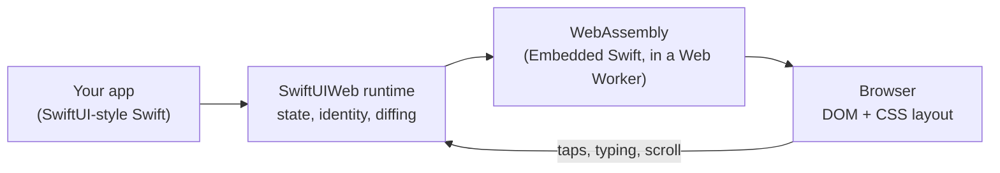

# SwiftUIWeb

Write a web app in Swift, the way you write SwiftUI. You describe screens with `View`, `@State`, `@Observable`,
`NavigationStack`, `List` and the rest of SwiftUI's names; SwiftUIWeb compiles the app with Embedded Swift to
WebAssembly and runs it in the browser as ordinary DOM laid out by CSS. If you know SwiftUI, you already know how to use
it.

```swift
import SwiftUI
import SwiftUIWebBrowser

@main
struct CounterApp: BrowserApp {
  var body: some Scene {
    WindowGroup { CounterView() }
  }
}

struct CounterView: View {
  @State private var count = 0

  var body: some View {
    VStack(spacing: 12) {
      Text("Tapped \(count) times").font(.title)
      Button("Tap me") { count += 1 }
        .buttonStyle(.borderedProminent)
    }
    .padding()
  }
}
```

The view is plain SwiftUI: the package maps `import SwiftUI` to SwiftUIWeb (one line in `Package.swift`, below). Only
the entry point is the browser's own, `BrowserApp`.

> **Status: preview.** SwiftUIWeb works for real applications, but it is young: the API may still change before 1.0
> (each break is described in the [migration guide](Documentation/MIGRATION.md)), and the download is larger than a
> JavaScript framework's (see [Limitations](#limitations)). Try it, report what breaks, and pin a version.

## Why

- **Share code with your Apple apps.** The same SwiftUI sources can build for iOS and iPadOS in Xcode and for the web
  ([sharing code with an Apple app](Documentation/SHARING_CODE.md)).
- **Feel native in the browser.** The screen is real DOM, not pixels painted into a canvas, so text selection, find in
  page, autofill, zoom, the back button and screen readers work as on any website.
- **Swift where Swift is good, the browser where the browser is good.** Swift keeps state, view identity, composition
  and structured concurrency; the browser keeps text, scrolling, CSS layout and accessibility.

## Quick start

**You need** a [Swift 6.4 toolchain from swift.org](https://www.swift.org/install/) (Xcode's compiler does not build
WebAssembly), the **Swift SDK for WebAssembly** of that same release, and **[Bun](https://bun.sh)**, on macOS 14+ or
Linux. The [quickstart](Documentation/QUICKSTART.md#requirements) has the install commands, and `./swiftweb doctor`
tells you what is missing.

**1. Create a package** with two files:

```swift
// Package.swift
// swift-tools-version: 6.4
import PackageDescription

let package = Package(
  name: "MyApp",
  dependencies: [
    .package(url: "https://github.com/Vitorsilveira31/SwiftUIWeb.git", from: "0.1.37")
  ],
  targets: [
    .executableTarget(
      name: "MyApp",
      dependencies: [
        .product(name: "SwiftUIWeb", package: "swiftuiweb"),
        .product(name: "SwiftUIWebBrowser", package: "swiftuiweb"),
      ],
      // `import SwiftUI` compiles against SwiftUIWeb, so your views read exactly as on iOS.
      swiftSettings: [.unsafeFlags(["-module-alias", "SwiftUI=SwiftUIWeb"])]
    )
  ]
)
```

and `MyApp/Sources/MyApp/MyApp.swift` with the app above.

**2. Run it:**

```sh
swift package --allow-writing-to-package-directory web init   # once: writes ./swiftweb
./swiftweb dev      # builds, serves (it prints the address) and reloads the page when you save
```

**3. Ship it:** `./swiftweb build` writes a folder of static files to upload to any static host; see
[deploying](Documentation/DEPLOYMENT.md).

The [quickstart](Documentation/QUICKSTART.md) goes further: the project layout, navigation and URLs, networking,
resources and fonts, testing your app, and what to do when something fails.

## What works today

Most SwiftUI code compiles as it is. The browser counterparts below are checked by the
[feature matrix](Documentation/FEATURE_MATRIX.md), which ties each one to the code and tests that back it.

| Area | What you get |
|---|---|
| Views and layout | Stacks, grids, `List`, `Form`, `ScrollView` with lazy stacks, `GeometryReader`, `containerRelativeFrame`, custom `Layout`, shapes, `Canvas`, gradients including `MeshGradient`, `Image` with asset catalogs and SF Symbol names |
| State and data flow | `@State`, `@Binding`, `@Observable`, `@Environment`, `ObservableObject`/`@Published`/`@StateObject`, `@AppStorage` |
| Navigation and presentation | `NavigationStack` and `NavigationSplitView` synced with the URL, back/forward and deep links; `TabView`; sheets with detents, popovers, alerts, confirmation dialogs, context menus |
| Controls | Buttons and button styles, toggles, pickers (segmented, menu, wheel), sliders, steppers, text fields, date pickers, `PasteButton`, keyboard shortcuts, drag and drop |
| Motion | Animations, transitions, `matchedGeometryEffect`, phase and keyframe animators, shape trims |
| Concurrency | `async`/`await`, `.task`, `AsyncStream`, the main actor; the Swift side runs in a Web Worker by default so heavy work never blocks typing or scrolling |
| Foundation | `WebFoundation`, the parts apps use under Apple's names: `Data`, `Date`, `URL`, `UUID`, `Codable` and JSON, `URLSession` over `fetch`, `UserDefaults`, `NSPredicate`, number and date formatting through `Intl` |
| Apple frameworks | Browser counterparts of Charts, MapKit (MapLibre, no key needed), AVFoundation and AVKit (MP4, HLS, DASH), PhotosUI, CoreLocation, UserNotifications, Security (a keychain encrypted in IndexedDB), UniformTypeIdentifiers and `Transferable` |
| The web | `WebContentView` for URLs and HTML, `DOMViewRepresentable` to host any DOM element or JavaScript widget, localization with string catalogs, a prerendered first screen in `index.html` |

## Limitations

The full list, with what to write instead, is in [`Documentation/LIMITATIONS.md`](Documentation/LIMITATIONS.md). The
ones to know before you start:

- **The first download is large.** An app ships its Swift runtime and views as one `app.wasm`. The counter above is
  about 400 KB with Brotli, and the component playground, which uses most of the framework, about 930 KB. In the
  [React comparison](Benchmarks/ReactComparison/README.md) a small board app transfers 552 KB against React's 57 KB, and on
  a slow 4G connection takes about 3.1 s to show its first screen against React's 0.6 s. Once loaded, interactions are on
  par. Smaller output is on the roadmap.
- **No Combine, no UIKit or AppKit.** `sink`, subjects and `.onReceive` are not available (use `@Observable`,
  `async`/`await` and `AsyncStream`); host DOM elements with `DOMViewRepresentable` instead of `UIViewRepresentable`.
- **Embedded Swift.** No reflection (`Mirror`), limited dynamic casts, and no `[String: Any]`. The source lowerer
  generates `Codable` conformances, since Embedded Swift does not.
- **No browser counterpart:** SwiftData, WidgetKit, App Intents, StoreKit, CloudKit, Metal, SpriteKit, SceneKit and
  RealityKit. Haptics (`sensoryFeedback`) compile and do nothing.
- **One Swift thread.** Swift runs in a Web Worker, off the page's main thread, so its work never blocks typing or
  scrolling; but it is one thread. `async`/`await` interleaves tasks there rather than running them in parallel on
  several cores.
- **Browsers.** The browser suites run in Chromium and in WebKit (Safari's engine). Firefox is expected to work but is
  not yet part of the automated tests.
- **Toolchain.** Building needs the swift.org Swift 6.4 toolchain and the WebAssembly SDK of that exact release; Xcode
  does not build the web target itself, so `./swiftweb dev` runs in a terminal next to it.
- **Hosting.** The app must be served from the root of its domain; a sub-path such as `example.com/app/` is not
  supported yet ([deploying](Documentation/DEPLOYMENT.md)).

## Roadmap

What comes next, roughly in order. Progress is tracked in the repository's
[milestones](https://github.com/Vitorsilveira31/SwiftUIWeb/milestones).

- **Smaller and faster first load:** split the WebAssembly by screen and keep shrinking what Embedded Swift emits.
- **A faster development loop:** hot swap of changed modules and live editing of literal values without a rebuild.
- **Closing SwiftUI gaps:** the APIs that real apps and Apple's samples still find missing or different.
- **Firefox** in the automated browser tests.
- **A stable API and 1.0**, with semantic versioning from then on.

Ideas and requests are welcome in [Discussions](https://github.com/Vitorsilveira31/SwiftUIWeb/discussions).

## Examples

`make list` shows them and `make run <name>` builds, serves and opens one. Among them:

| Example | What it shows |
|---|---|
| [`ShowcaseSite`](Examples/ShowcaseSite/README.md) | The project site: a catalog of components with live knobs and the code they produce |
| [`Lumio`](Examples/Lumio/README.md), [`Quill`](Examples/Quill/README.md), [`Mailo`](Examples/Mailo/README.md), [`Stayly`](Examples/Stayly/README.md) | Full apps (photos, short posts, mail, stays) over a local mock API, with tests |
| [`UniversalApp`](Examples/UniversalApp/README.md) | One package for iOS, iPadOS and the web |
| [`FoodTruck`](Examples/FoodTruck/README.md) | Apple's Food Truck sample: the same sources run in the browser and as an iOS and iPadOS app |

All of them are in [`Examples/`](Examples/README.md).

## How it works



1. Your code builds a tree of views.
2. The runtime keeps track of which view is which, so a change touches only what changed.
3. It sends small binary patches to the page, which applies them to the real DOM.
4. The browser lays the page out with CSS and sends user input back to Swift.

The project is two languages with one job each: **Swift** for the SwiftUI-shaped API and everything that decides what
the screen shows, and **JavaScript** as a thin adapter to the browser's own APIs (DOM, `fetch`, storage, media, `Intl`).
[`Documentation/ARCHITECTURE.md`](Documentation/ARCHITECTURE.md) explains the pieces.

| Folder | What it holds |
|---|---|
| [`Sources/`](Sources/README.md) | The framework, split in modules |
| [`Plugins/`](Plugins/README.md) | The SwiftPM plugins that set up and build your app |
| [`Tools/`](Tools/README.md) | The launcher, the source lowerer, the JavaScript page host, audits and benchmarks |
| [`Examples/`](Examples/README.md) | Runnable apps |
| [`Tests/`](Tests/README.md) | Swift and browser tests and their fixtures |
| [`Documentation/`](Documentation/README.md) | Architecture, contracts and guides |

## Contributing

Contributions are welcome. [`CONTRIBUTING.md`](CONTRIBUTING.md) explains where code goes, how to build and test
(`make setup`, `make test`, `make run`) and what a pull request needs. A difference from Apple's SwiftUI counts as a bug:
open an issue with the "SwiftUI API missing or different" template. Please follow the
[code of conduct](CODE_OF_CONDUCT.md), and report security problems privately as described in [`SECURITY.md`](SECURITY.md).

## Acknowledgements

SwiftUIWeb stands on the work of the projects that brought SwiftUI-style code to the browser before it:
**[Tokamak](https://github.com/TokamakUI/Tokamak)**, which showed years before Embedded Swift that SwiftUI's API could
run in a browser, and **[ElementaryUI](https://github.com/elementary-swift/elementary-ui)**, which showed that a reactive
Swift UI framework on Embedded Swift can ship small WebAssembly and lean on CSS for animation.

And on the work underneath: the [SwiftUI](https://developer.apple.com/documentation/swiftui) team at Apple, for an API
that says what a screen is rather than how to draw it; the [Swift community](https://www.swift.org/community/), for
[Embedded Swift](https://www.swift.org/get-started/embedded/) and the WebAssembly target, and
[SwiftWasm](https://swiftwasm.org) for keeping Swift on WebAssembly going long before it was upstream; the people behind
[React](https://react.dev), whose Fiber reconciler gave the runtime its name and its persistent tree; and everyone who
builds the web platform and its engines.

The libraries and tools SwiftUIWeb uses, with thanks to the people who make them:

| Project | What it does here |
|---|---|
| [Bun](https://bun.sh) | Runs every build script, test and audit, and serves the apps in development, fast enough that the tooling stays out of the way |
| [swift-syntax](https://github.com/swiftlang/swift-syntax) | The parser the source lowerer is built on |
| [Swift Crypto](https://github.com/apple/swift-crypto) and [Swift ASN.1](https://github.com/apple/swift-asn1) | Cryptography on every host, including the keychain |
| [Playwright](https://playwright.dev) | Drives Chromium and WebKit in the browser tests |
| [Lucide](https://lucide.dev) (and [Feather](https://feathericons.com), which it grew from) | The icons behind SF Symbol names |
| [Tailwind CSS](https://tailwindcss.com) | Its preflight is the starting point of the stylesheet's reset |
| [Shaka Player](https://github.com/shaka-project/shaka-player) | Adaptive streaming (HLS, DASH) for `AVPlayer` and `VideoPlayer` |
| [MapLibre GL JS](https://maplibre.org), [PMTiles](https://protomaps.com) and [OpenStreetMap](https://www.openstreetmap.org) | The map behind MapKit's `Map`, and the data it shows by default |
| [Binaryen](https://github.com/WebAssembly/binaryen), [Brotli](https://github.com/google/brotli) and [Zstandard](https://github.com/facebook/zstd) | Optimize and compress the release bundles |
| [Food Truck](https://developer.apple.com/documentation/swiftui/food_truck_building_a_swiftui_multiplatform_app), Apple's sample | The SwiftUI app the `FoodTruck` example runs in the browser |
| [Blockly](https://developers.google.com/blockly) | The editor the `BlocklyInterop` example mounts |
| [JSONPlaceholder](https://jsonplaceholder.typicode.com) | The shape of the mock API the example apps use |

## License

SwiftUIWeb is licensed under the [Mozilla Public License 2.0](LICENSE). You can use it in closed-source applications; if
you change a file of the framework itself and distribute it, share that file's changes under the same license.
Third-party code and the parts under other licenses are listed in [`THIRD_PARTY_NOTICES.md`](THIRD_PARTY_NOTICES.md).
