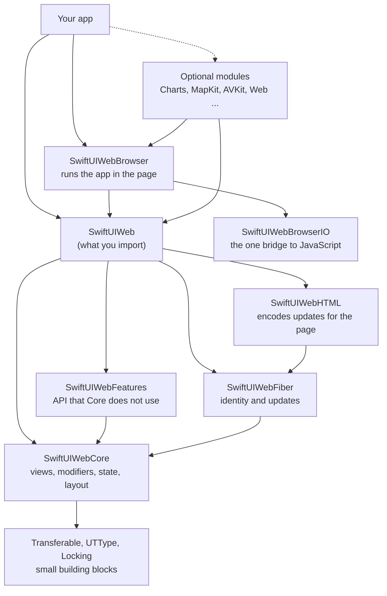
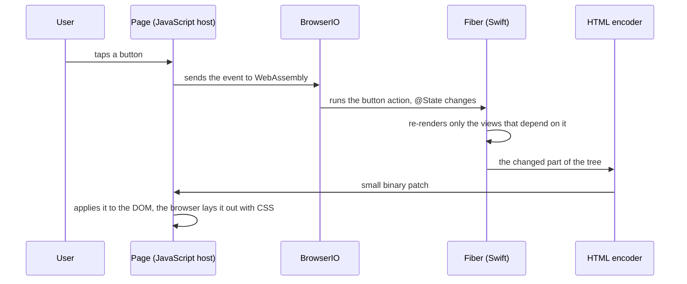

# Sources: the framework, module by module
| `SwiftUIWebFeatures` | The part of the SwiftUI-shaped API that nothing in Core, Features uses: `@AppStorage`/`UserDefaults`, `AttributedString`, file documents, `OutlineGroup`, split views, phase and keyframe animators, `PasteButton`, hover and pointer modifiers, `IndexSet`, ISO 8601 and number formatting helpers, and other leaves. It is its own module only so that an edit recompiles less; apps see it through `SwiftUIWeb`. | Core, Transferable |

SwiftUIWeb is split into small Swift modules (SwiftPM targets). Each one has a single job, and the arrows between them
only point one way, from a module to the ones it needs. An app normally imports two of them:

- `SwiftUIWeb`, which re-exports the SwiftUI-shaped API;
- `SwiftUIWebBrowser`, which turns the app into a browser app (`BrowserApp`).

Everything else is either an internal layer or an optional feature you add when you need it.

## The big picture

Read it from the top: your app sits on the browser host and the facade; the facade sits on the runtime (Fiber, HTML) and
the API (Core, and Features above it); Core sits on a few tiny building blocks. Optional modules plug in on the side.

## How a tap becomes a screen update

The Swift side can run in a Web Worker (the default), so the patch travels from the worker to the page. See
[`Documentation/EmbeddedWorker.md`](../Documentation/EmbeddedWorker.md).

## All modules

### The API and the runtime

| Module | What it does | Needs |
|---|---|---|
| `SwiftUIWeb` | The module apps import. It has almost no code of its own (the app entry runtime and key characters): it re-exports Core, Features, Internationalization, Networking, WebFoundation, Fiber, HTML and Transferable, on every host. | all of those |
| `SwiftUIWebCore` | The SwiftUI-shaped API: `View`, the modifiers, `@State` and `@Environment`, stacks, lists, navigation, gestures, animation, accessibility and the layout intent. It knows nothing about the browser, so the same code is testable natively. By far the biggest module. | Transferable |
| `SwiftUIWebFiber` | The runtime that keeps a tree of views alive: it gives each view a stable identity, decides what changed after a state change, and manages lazy lists. Only the changed subtree is redone. | Core |
| `SwiftUIWebHTML` | Encodes the rendered tree into the compact binary stream the page applies to the DOM (the browser does not parse HTML for updates). It also has a plain HTML writer used by tests. | Core, Fiber |
| `SwiftUIWebInternationalization` | Dates, numbers and `DatePicker`, written without Foundation so they work in WebAssembly. | Core |
| `SwiftUIWebNetworking` | `URLSession`, `URLRequest`, cookies and `URLError` for the browser, using `fetch`. Natively it steps aside and Foundation is used. | Core, Transferable |

### The browser side

| Module | What it does | Needs |
|---|---|---|
| `SwiftUIWebBrowser` | The browser host. It defines `BrowserApp` (your `@main`), mounts the app in the page, emits the CSS layout, and handles history, canvas, drag and drop, timelines and optional features loaded on demand. | SwiftUIWeb, BrowserIO and most modules below |
| `SwiftUIWebBrowserIO` | The single Swift-to-JavaScript bridge: events, DOM commits, timers, storage, cookies, text. Its operation numbers are generated from [`Documentation/BrowserIO/PROTOCOL.json`](../Documentation/BrowserIO/PROTOCOL.json). | CSwiftUIWebBrowserIO, Locking |
| `CSwiftUIWebBrowserIO` | A tiny C layer with the entry points WebAssembly calls into. Embedded Swift needs it to hook up concurrency to the browser event loop. | none |

### Stand-ins for Apple frameworks

These give code written for Apple platforms the same names in the browser, so it compiles unchanged.

| Module | Stands in for | What it does |
|---|---|---|
| `WebFoundation` | Foundation | JSON, `NSPredicate`, measurements, locale and the other Foundation names Embedded Swift lacks. An app aliases `Foundation` to it. |
| `WebOSLog` | OSLog | `Logger` that writes to the browser console. |
| `SwiftUIWebUniformTypeIdentifiers` | UniformTypeIdentifiers | A small `UTType`. Natively it re-exports Apple's. |
| `SwiftUIWebTransferable` | Transferable, Codable | `Transferable`, plus the Codable replacement that Embedded Swift needs after source lowering. |
| `SwiftUIWebCrypto` | CryptoKit | SHA-2 hashes, HMAC, AES, P-256 and Curve25519. It is Swift Crypto on every host, the open-source CryptoKit API. |
| `SwiftUIWebSecurity` | Security | `SecItem` keychain calls, backed by encrypted IndexedDB, and web sessions. |
| `SwiftUIWebCoreLocation` | CoreLocation | Location services through the browser. |
| `SwiftUIWebUserNotifications` | UserNotifications | Permission and local notifications. |

### Optional features

An app only pays for what it imports (the release build also drops what the app never reaches).

| Module | What it adds | Needs |
|---|---|---|
| `SwiftUIWebCharts` | Swift Charts: `Chart`, marks, axes. | Core, Internationalization |
| `SwiftUIWebMapKit` | `Map` with markers, overlays and camera, drawn by MapLibre (no API key by default). | Core, CoreLocation, Browser |
| `SwiftUIWebAVFoundation` | `AVPlayer`-shaped playback that controls a native media element. | SwiftUIWeb, Browser, BrowserIO, WebFoundation |
| `SwiftUIWebAVKit` | `VideoPlayer` with ready-made controls, on top of AVFoundation (MP4, HLS, DASH). | SwiftUIWeb, AVFoundation |
| `SwiftUIWebPhotosUI` | `PhotosPicker`, reading files from the browser. | SwiftUIWeb, Transferable |
| `SwiftUIWebWeb` | `WebContentView` (a web view), `DOMViewRepresentable` for mounting your own DOM, document head and credentials. | Core, Networking, Transferable |

### Small helpers

| Module | What it does |
|---|---|
| `SwiftUIWebLocking` | A minimal lock for the few process-wide registries that native hosts and tests touch from several threads. The Swift side of a browser app runs on one thread (a Web Worker by default). |
| `SwiftUIWebEmbeddedCoreProbe` | Not shipped. A tiny target the size tools build to measure what the minimum WebAssembly artifact costs (see [`Documentation/Performance/WASM_SIZE.md`](../Documentation/Performance/WASM_SIZE.md)). |

## Rules that keep the modules honest

- **Core stays renderer-neutral.** Anything that mentions the DOM, JavaScript or a map provider lives in a module above
  Core, never in it.
- **One bridge.** Only `SwiftUIWebBrowserIO` talks to JavaScript. The other modules call it, they do not reach into the page.
- **Optional means optional.** Mapping, media, charts and the rest are separate products so an app that does not use them
  does not ship them.
- **Apple names win.** A public API that mirrors an Apple framework keeps Apple's name and shape. The public surface is
  tracked in [`Documentation/API/public-api.json`](../Documentation/API/public-api.json).

For the reasoning behind the layers, read [`Documentation/ARCHITECTURE.md`](../Documentation/ARCHITECTURE.md).
