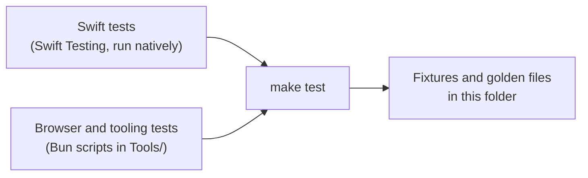

# Tests

Two kinds of tests live here, and the folders below tell you which is which.



- **Swift tests** run natively with `swift test`. They check the API, state, identity and layout rules without a browser.
- **Browser tests** are scripts in [`Tools/`](../Tools/README.md) (`test-*.mjs`) that open the real WebAssembly bundle in
  Chromium and WebKit. Their inputs (fixtures, golden files) are in this folder.

## Swift test targets

| Folder | What it tests |
|---|---|
| `SwiftUIWebTests` | The main suite, one file per behaviour: views and modifiers, state, identity, layout, lazy lists, gestures, networking, storage, accessibility, benchmarks. |
| `SwiftUIWebCryptoTests` | `SwiftUIWebCrypto` (hashes, HMAC, AES, keys). |
| `SwiftUIWebSecurityTests` | `SwiftUIWebSecurity` (keychain items, sessions). |
| `SwiftUIWebUserNotificationsTests` | `SwiftUIWebUserNotifications`. |
| `EmbeddedJSONTests` | The JSON code used in the Embedded runtime. |
| `ShowcaseSiteTests` | `ShowcaseSite`, the project site: its component catalog, code builder and performance view model. |
| `CloneKitTests` | `CloneKit`, the typed client and models for the mock API. |
| `LumioTests` | The Lumio example, against doubles (view models, repositories). |
| `QuillTests` | The Quill example, against doubles. |
| `SeekrTests` | The Seekr example, against doubles. |
| `NeighborlyTests` | The Neighborly example, against doubles. |
| `StaylyTests` | The Stayly example, against doubles. |
| `MailoTests` | The Mailo example, against doubles. |

The source lowerer has its own tests in `Tools/SwiftUIWebLowering/Tests`.

## Fixtures and golden files

A fixture is data a test reads; none of it is imported by the framework. A golden file is a saved answer the test compares with.

| Folder | What it holds |
|---|---|
| `Fixtures` | Binary publication samples, the `NSPredicate` corpus and a two-second HLS stream (`AdaptiveMedia`: two renditions, two audio languages, two subtitle tracks). |
| `LayoutConformance` | Box sizes measured on Apple platforms and the CSS boxes the web build produces, compared by `Tools/LayoutConformance`. |
| `Apps` | The test apps the browser tests build and drive (see [`Apps/README.md`](Apps/README.md)). |
| `EmbeddedUI` | A host page, a root script and small apps used by the browser and lowering tests. |
| `FeatureMatrix` | `manifest.json`, the list of capabilities and the files that prove each one (see [`Documentation/FEATURE_MATRIX.md`](../Documentation/FEATURE_MATRIX.md)). |
| `BrowserIO` | Tests for the JavaScript half of BrowserIO. |
| `CrossPackage` | A small app in another package that uses SwiftUIWeb, to prove the public API works across a package boundary (`make cross-package-test`). |
| `ConsumerRegression` | A consumer app built the way a user would build one (`make consumer-regression`). |
| `HostileValues` | Far dates, huge numbers, deep JSON and odd URLs, as an app may receive them, run in the Embedded build where `Int` is 32 bits; none may trap the app (`make hostile-values-browser-test`). |

## Running

```sh
make test                  # everything above that is native, plus tooling and documentation checks
make docs-test             # only the documentation checks
swift test --enable-swift-testing --disable-xctest --filter GeometryCompatibilityTests   # one suite
```

How tests, fixtures and examples are kept apart is explained in [`Documentation/TEST_LAYOUT.md`](../Documentation/TEST_LAYOUT.md).
