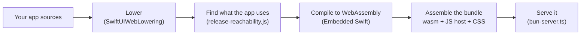
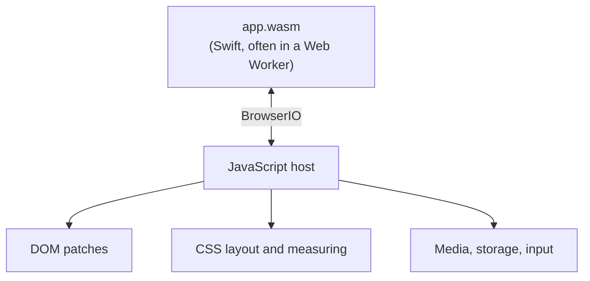

# Tools

Everything that builds, serves, checks and measures SwiftUIWeb, except the framework itself. There are many files here;
this page tells you which group to look in. Most of them are small scripts in JavaScript (run with Bun) or shell; the one
big Swift piece is the source lowerer.

## From source to a page in the browser

`Tools/run-browser.sh` runs this whole chain (through `run-browser-embedded.sh`); `swiftuiweb-run.swift` is the same thing for
an app in another package. Both are what `make run` and the [SwiftPM plugin](../Plugins/SwiftUIWebPlugin/README.md) call.

## What runs inside the page

The bundle carries a small JavaScript host. It owns what only the browser can do, and talks to the Swift side through
BrowserIO.

| Group | Files | What they do |
|---|---|---|
| Runtime and DOM | `embedded-runtime.js`, `embedded-dom.js`, `embedded-worker.js`, `embedded-worker-client.js`, `binary-publication.js`, `build-runtime-bundle.mjs` | Start the WebAssembly app, run it in a Worker, and apply the binary patches Swift sends to the DOM. `build-runtime-bundle.mjs` builds the runtime and the worker with one shared chunk, puts the page hosts the first screen does not run in `runtime-deferred.js` (`deferred-hosts.js`, loaded right after the first publication), and leaves out of a release the hosts it does not reach. |
| Layout | `css-layout.js`, `layout-host.js`, `geometry-host.js`, `text-layout-host.js` | Turn the layout intent Swift describes into flexbox and grid styles, and report measured sizes back. |
| Browser features | `media-host.js`, `host-interactions.js`, `presentation-host.js`, `transfer-host.js`, `split-view-host.js`, `tab-shell.js`, `feature-loader.js`, `mesh-gradient.js` | One host per feature (media playback, drag and drop, split views, tabs, features loaded on demand). |
| BrowserIO | [`BrowserIO/`](BrowserIO) | The JavaScript half of the Swift-to-browser bridge (fetch, IndexedDB, cookies, text, predicates) and its own host tests. |

## Build, launch and serve

| Files | What they do |
|---|---|
| `run-browser.sh`, `run-browser-embedded.sh`, `swiftuiweb-run.swift` | The launchers: build an example or your own package and serve it. |
| [`SwiftUIWebLowering/`](SwiftUIWebLowering/README.md), `swiftuiweb-lowering.sh` | The source lowerer and the script that builds and calls it. |
| `release-reachability.js`, `embedded-capabilities.mjs`, `embedded-preflight.mjs` | Work out which optional features an app reaches and check the toolchain before building. |
| `compile-assets.mjs`, `compile-strings.mjs`, `build-styles.mjs`, `inject-app-head.mjs` | Prepare asset catalogs, strings, styles and the page head. |
| `precompress-bundle.mjs`, `hash-release-bundle.mjs`, `measure-bundle.mjs` | Compress, fingerprint and measure the release bundle. |
| `wasm-split-release.mjs`, `wasm-split-loader.js` | Split a release app.wasm by what the first screen runs, and load the rest behind it (opt-in, `SWIFTUIWEB_WASM_SPLIT=1`). |
| `bun-server.ts`, `dev-watch.mjs`, `live-reload.mjs` | The local server and the watch/reload loop. |

## Checks

| Files | What they check |
|---|---|
| `test-*.mjs` | Browser and tooling tests, one per behaviour (scrolling, presentation, accessibility, geometry, security ...). Run through the `make ...-test` targets. |
| `audit-*.mjs`, `check-*.js`, `api-contract.mjs` | Repository rules: documentation links, the single browser runtime, the public API contract, test layout, and that every public view has an entry in the site's component catalog (`audit-showcase-catalog.mjs`). |
| [`LayoutConformance/`](LayoutConformance) | Compares the box sizes SwiftUI reports on Apple platforms with the ones the web build lays out. |

## Measuring speed and size

| Files | What they do |
|---|---|
| `perf-ab.mjs`, `frame-budgets.mjs`, `performance-contracts.mjs`, `frame-measure.mjs` | A/B comparisons and frame-time budgets (see [`Documentation/Performance`](../Documentation/Performance)). |
| `mock-jsonplaceholder.mjs`, `mock-api/` | A jsonplaceholder-compatible API that runs on this machine, for the example apps that call a network: the same resources, fields and counts (users, posts, comments, albums, photos, todos), nested routes, json-server queries (`_page`, `_limit`, `_sort`, `_embed`, `q`, filters), writes and pictures drawn on the spot under `/images/`. The launcher starts it for an example with an `Examples/<Product>/.mock-api` marker and the dev server forwards `/api` to it; `API=real` answers the data from jsonplaceholder.typicode.com instead. |
| `compare-react.mjs`, `publish-react-comparison.mjs` | The same app in SwiftUIWeb and in React, measured alike, and the script that publishes the results to the site's Performance page (see [`Benchmarks/ReactComparison`](../Benchmarks/ReactComparison/README.md)). |
| `benchmark-embedded-core.js` | Measures the small Embedded Swift Core artifact on its own (no WASI or browser host), with a deterministic exported function. `Tools/build-embedded-core.sh` runs it. |
| `analyze-wasm-size.js`, `analyze-wasm-data.js`, `wasm-size.mjs`, `check-wasm-exports.mjs` | Where the WebAssembly bytes go. |

To list the commands you are expected to run, read the [`Makefile`](../Makefile) or
[`Documentation/DEVELOPMENT_WORKFLOW.md`](../Documentation/DEVELOPMENT_WORKFLOW.md).
