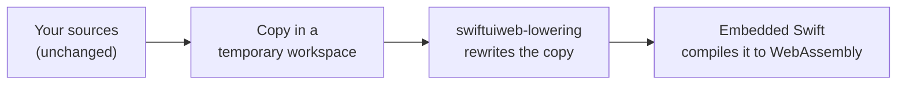

# SwiftUIWebLowering

The **source lowerer**: a Swift command-line tool, built on SwiftSyntax, that rewrites a *disposable copy* of your app
just before it is compiled for WebAssembly. Your real files are never changed.

## Why it exists

Embedded Swift (the small Swift used for WebAssembly) cannot compile a few things SwiftUI-style code uses every day: for
example `@Observable` classes, `Codable`, and some key-path spellings. Instead of asking you to write differently, the
lowerer rewrites those constructs into forms Embedded Swift accepts.



## What it rewrites

Each rule lives in its own file under `Sources/LoweringCore`. The main ones:

- **Observation.** `@Observable` stored members become sources the state store can track, so a change re-renders only the
  views that read it (`Observable.swift`, `ObservableState.swift`).
- **Codable.** Synthesized `Codable` becomes the compile-time serialization contract in `SwiftUIWebTransferable`
  (`EmbeddedCodable.swift`, `CodableMembers.swift`).
- **Key paths and platform checks.** SwiftUI-shaped key-path spellings, and `os(macOS)` in an `#if`, which counts as true
  because a browser is a desktop host (`KeyPathSupport.swift`, `PlatformCondition.swift`).
- **Browser exports.** The entry points the page calls into the WebAssembly module (`BrowserExports.swift`).
- **Previews.** `#Preview` blocks and `PreviewProvider` types are removed (`PreviewRemoval.swift`).

It also writes a JSON report of every rewrite, with a line map back to your original code, and it **fails closed**: if it
cannot lower something safely, it stops with an error that points to the original `file:line:column` instead of guessing.

## Run it

You normally never run it by hand: every browser build calls it through `Tools/swiftuiweb-lowering.sh`, which builds this
package once (the first build compiles swift-syntax and takes a couple of minutes) and reuses it after that.

```sh
Tools/swiftuiweb-lowering.sh --apply --root . --product ShowcaseApp --workspace .build/lowering-workspace
```

Its tests are in `Tests/LoweringCoreTests` and run with `make lowering-unit-test`: one suite per rewrite, each lowering a small
source and asserting on the result. The full contract, every flag and the diagnostics format are in
[`Documentation/EMBEDDED_SOURCE_LOWERING.md`](../../Documentation/EMBEDDED_SOURCE_LOWERING.md).
